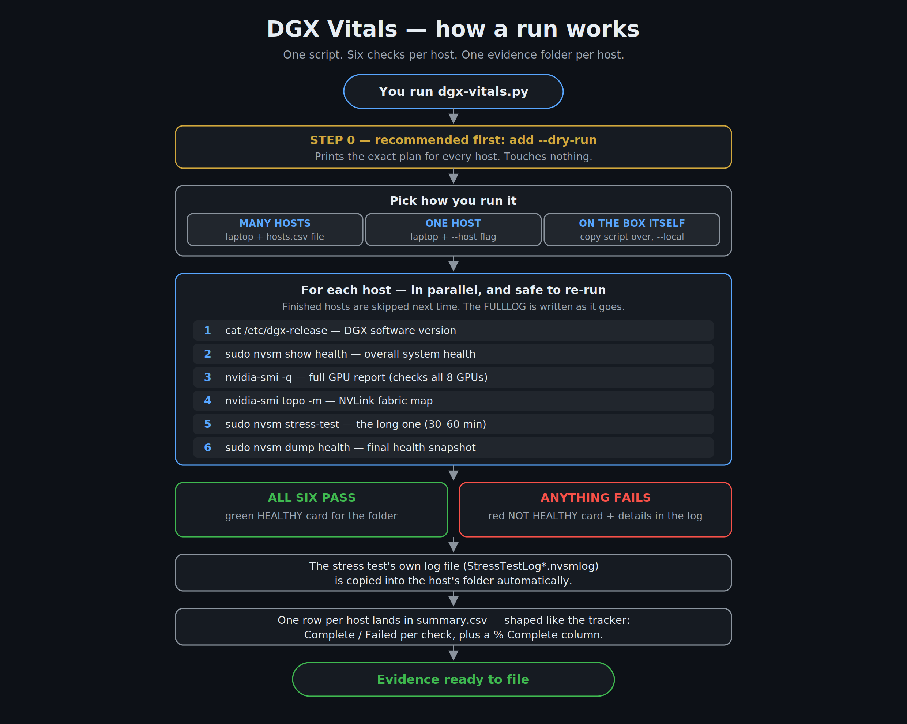
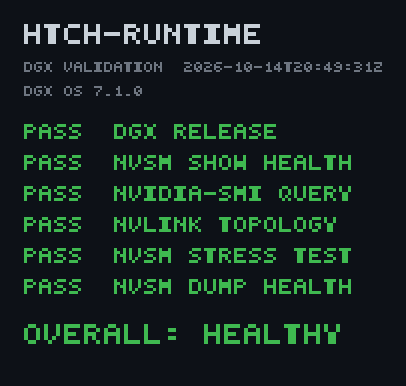

# DGX Vitals

**Takes a DGX's vitals.** One script runs the six standard DGX validation
checks on one machine — or a whole fleet over SSH — and files the evidence
for you: a full log, a health card, and a tracker-ready summary. No manual
SSH sessions, no screenshots, no typing results into a spreadsheet.



## Getting DGX Vitals

**If you're comfortable with GitHub** — clone the repo (same name on the
work account):

```
gh repo clone altonhill/dgx-vitals
```

—or with plain git:

```
git clone https://github.com/altonhill/dgx-vitals.git
```

**If you'd rather not touch GitHub at all** — one command downloads the
whole thing as a zip:

```
curl -L -o dgx-vitals.zip https://github.com/altonhill/dgx-vitals/archive/refs/heads/main.zip
```

On Windows, run that in PowerShell exactly as written (Windows ships
`curl.exe`). Then unpack it — `Expand-Archive dgx-vitals.zip` in
PowerShell, `unzip dgx-vitals.zip` on Mac/Linux, or just right-click →
Extract All — and work inside the `dgx-vitals-main` folder it creates.

Either way, you end up with a folder containing `dgx-vitals.py`. That
script plus your `hosts.csv` (next section) is all you need.

## What you get

For every host, a folder with:

- **`<hostname>-FULLLOG.txt`** — everything the checks printed, word for word
- **`<hostname>-HEALTHY.png`** — the health card (green = healthy, red = not)
- **`StressTestLog*.nvsmlog`** — the stress test's own log file, when it writes one

Plus one **`summary.csv`** for the whole run — one row per host, with a
Complete / Failed cell per check and a % Complete column, shaped to paste
straight into the install tracker.



## The six checks

| # | Check | What it does |
|---|-------|--------------|
| 1 | DGX Release | Reads the DGX software version |
| 2 | NVSM Show Health | Overall system health report |
| 3 | NVIDIA-SMI Query | Full GPU report — verifies all GPUs are present |
| 4 | NVLink Topology | Maps the NVLink fabric between GPUs |
| 5 | NVSM Stress Test | Stresses the system (this is the long one — 30 to 60 minutes) |
| 6 | NVSM Dump Health | Final health snapshot |

## Before you start

You need three things:

1. **Python 3** on your laptop (instructions per system below — it's a
   one-time, five-minute install).
2. **The script and a hosts file** in the same folder: `dgx-vitals.py`
   and your `hosts.csv`. The hosts file is one machine per line, in any
   of these shapes — `hostname,address,user`, just `hostname,address`,
   just a hostname, or just an IP. The header row is optional. The
   hostname is the name used for the evidence folder; the address is the
   IP (or tailnet name) the tool connects to. See `hosts.example.csv`.
3. **SSH access** to the DGX machines with a key set up (the same access
   you'd use to log in by hand). If you can already SSH to the boxes,
   you're set.

Nothing else to install — the script uses only Python's built-in parts.

---

## Windows

1. **Install Python:** go to [python.org/downloads](https://www.python.org/downloads/),
   run the installer, and on the first screen **tick "Add python.exe to
   PATH"** before clicking Install.
2. Open the folder that contains `dgx-vitals.py` and your `hosts.csv`.
   Click the address bar in File Explorer, type `powershell`, press Enter —
   a PowerShell window opens already in that folder.
3. **Dry run first** (shows the plan, touches nothing):

   ```
   py dgx-vitals.py --hosts hosts.csv --out Results --dry-run
   ```
4. When the plan looks right, run it for real — same command, minus
   `--dry-run`:

   ```
   py dgx-vitals.py --hosts hosts.csv --out Results
   ```
5. Results land in the `Results` folder. The last line tells you where
   `summary.csv` is and flags any machine that came back **NOT HEALTHY**.

## Mac

1. **Python:** macOS may already have it. Open Terminal (Spotlight →
   "Terminal") and type `python3 --version`. If a version prints, you're
   set; if a pop-up offers developer tools, click Install and wait for it
   to finish. (Or install Python from python.org.)
2. In Terminal, go to the folder with the script — type `cd ` (with a
   space), drag the folder from Finder into the Terminal window, press
   Enter.
3. **Dry run first:**

   ```
   python3 dgx-vitals.py --hosts hosts.csv --out Results --dry-run
   ```
4. Then the real run:

   ```
   python3 dgx-vitals.py --hosts hosts.csv --out Results
   ```

## Linux

1. Python 3 is almost certainly already there: `python3 --version`.
2. In the folder with the script:

   ```
   python3 dgx-vitals.py --hosts hosts.csv --out Results --dry-run
   python3 dgx-vitals.py --hosts hosts.csv --out Results
   ```

---

## Other ways to run it

**Just one machine** (no hosts file):

```
py dgx-vitals.py --host dgx-node-01 --address 10.0.0.51 --user ubuntu --out Results
```

**Right on the DGX itself** (copy the script to the box first):

```
python3 dgx-vitals.py --local --out Results
```

**Interrupted?** Just run the same command again. Hosts that already have
a finished log are skipped; the run picks up where it left off. Add
`--force` only if you truly want to redo finished hosts.

## Handy options

| Option | What it does |
|--------|--------------|
| `--dry-run` | Print the plan and sample output — touches nothing |
| `--jobs 8` | Check 8 hosts at a time (default 4) |
| `--only stress` | Run just one check (handy for a stress-test redo) |
| `--sudo-password` | Ask for the hosts' sudo password once, if they need one |
| `--stress-timeout 5400` | How long the stress test may run, in seconds (default fits a 60-minute test) |
| `--health-timeout 1800` | Time limit for NVSM Show Health, in seconds (it can take 15–20) |
| `--dump-timeout 1800` | Time limit for NVSM Dump Health, in seconds |
| `--force` | Redo hosts that already finished |

## If something goes wrong

| What you see | What it means / what to do |
|--------------|----------------------------|
| `'py' is not recognized` (Windows) | Python isn't on the PATH. Re-run the python.org installer and tick **"Add python.exe to PATH."** |
| `Permission denied (publickey)` | Your SSH key isn't accepted on that host yet. If you can't SSH in by hand either, sort that first — the tool uses the same access. |
| Steps 2, 5, or 6 fail instantly | Those need sudo. If the account has a sudo password, add `--sudo-password` and type it once when asked. |
| A host comes back NOT HEALTHY | Open that host's FULLLOG — the failing check and its full output are in there. The card tells you *that* it failed; the log tells you *why*. |
| The run got cut off mid-way | Re-run the same command. Finished hosts are skipped automatically. |

## Notes for maintainers

- PASS rules are deliberately simple (clean exit codes, all expected GPUs
  present, no *unhealthy / critical / fatal* in the health report). They
  live in one function — `verdict()` in `dgx-vitals.py` — and the FULLLOG
  always keeps the raw output, so a human can override any verdict.
- Targets are Ubuntu 24.04 / DGX OS. The stress-test log harvest looks in
  `$HOME`, `/var/log`, and `/tmp` for `*.nvsmlog` files created during the
  run.
