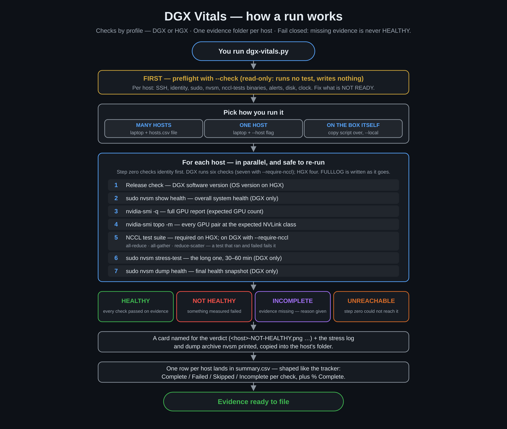
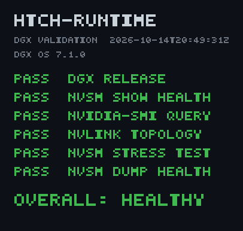
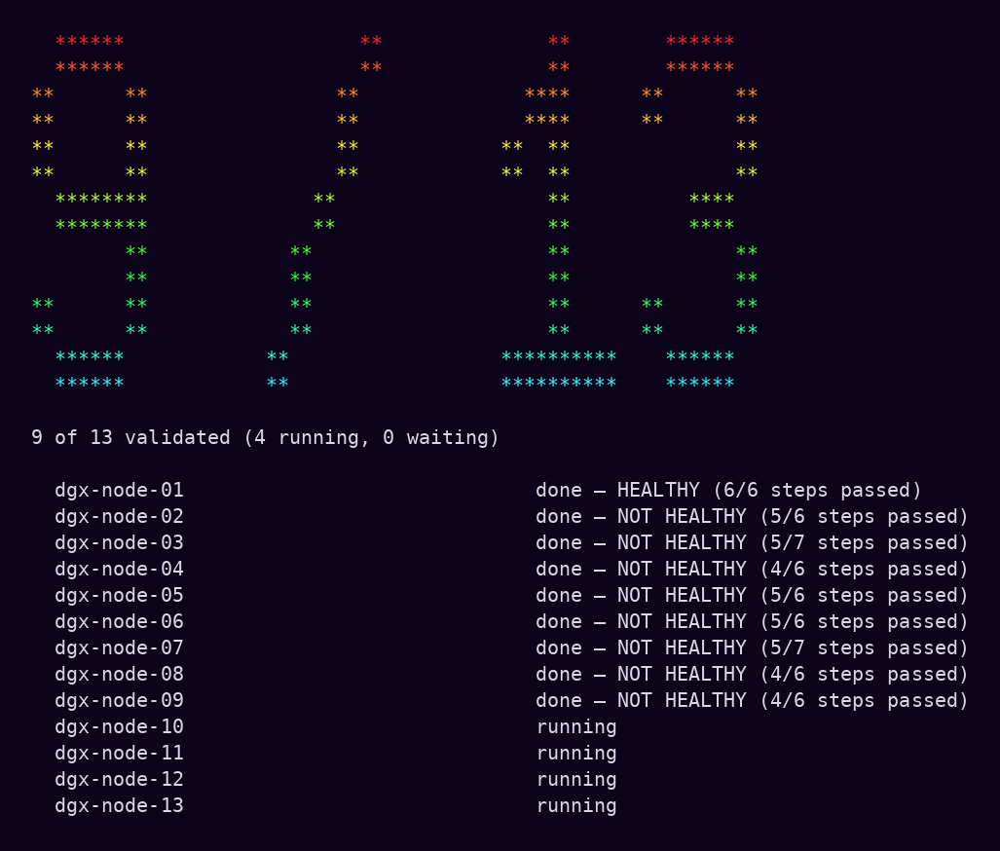
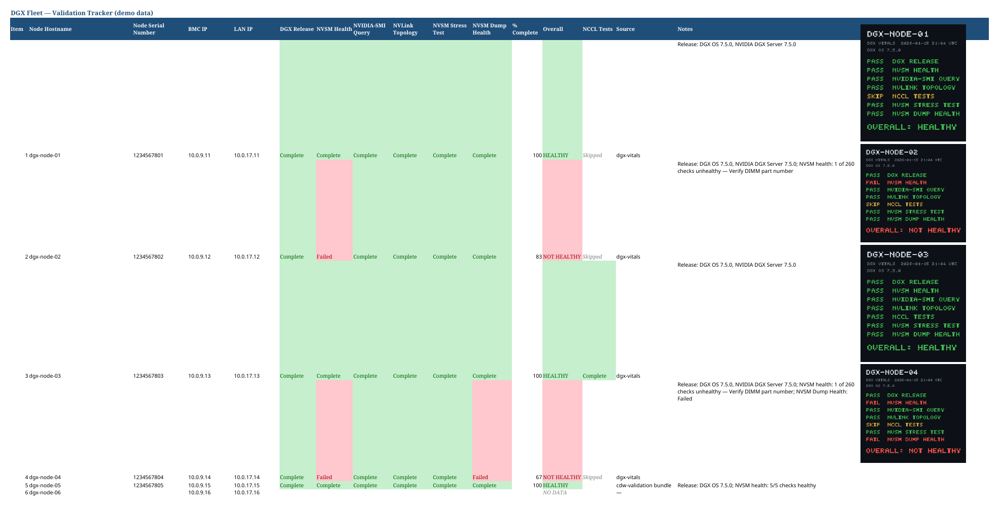

# DGX Vitals

**Takes a DGX's vitals.** One script runs the standard DGX validation
checks on one machine, or on a whole fleet over SSH, and files the
evidence for you: a full log, a health card and a tracker-ready summary.
You don't need manual SSH sessions or screenshots, and nobody types
results into a spreadsheet.

- **New to this?** [`QUICKSTART.md`](QUICKSTART.md) is the one-page field
  workflow: preflight, run, read the verdicts, build the sheet.
- **Running a site?** [`docs/OPERATORS-GUIDE.md`](docs/OPERATORS-GUIDE.md)
  is the full runbook: hosts files, password sites, re-runs, the
  scoreboard, the sheet, and common snags.



## Getting DGX Vitals

Clone the repository from wherever your team keeps it. Ask the
maintainer for the URL:

```
git clone <repository URL> dgx-vitals
```

If you don't use git, download the repository as a zip from the same
place. Unpack it with `Expand-Archive dgx-vitals.zip` in PowerShell,
`unzip dgx-vitals.zip` on Mac/Linux, or right-click → Extract All.

Either way, you end up with a folder containing `dgx-vitals.py` and
`tracker_build.py`. **Keep the two files together:** the sheet builder
imports the runner's verdict vocabulary and will not run without it.

## What you get

For every host, a folder with:

- **`<hostname>-FULLLOG.txt`**: everything the checks printed, word for
  word, and a trailer line per check with its verdict.
- **`<hostname>-<VERDICT>.png`**: the health card, named for the host's
  verdict: `-HEALTHY.png`, `-NOT-HEALTHY.png`, `-INCOMPLETE.png` or
  `-UNREACHABLE.png`. Runs made before v2.0 named every card
  `-HEALTHY.png`, whatever the verdict.
- **`StressTestLog*.nvsmlog`** and the **`nvsm-health-*` dump archive**:
  the exact files nvsm said it wrote, copied off the host.

Plus one **`summary.csv`** for the whole run: one row per host, with a
Complete / Failed / Skipped / Incomplete cell per check and a % Complete
column, shaped to paste into the install tracker.



## The checks

Which checks run depends on the **profile**: `--profile dgx` (the
default), `--profile hgx`, or `--profile auto` (each host's step zero
decides).

| Check | What it does | DGX | HGX |
|-------|--------------|:---:|:---:|
| Step zero (identity) | Asks the host its hostname, chassis serial and platform; stops the host if they don't match the hosts file | ✓ | ✓ |
| Release | DGX software version (plain OS version on HGX) | ✓ | ✓ |
| NVSM Show Health | Overall system health report (sudo) | ✓ | — |
| NVIDIA-SMI Query | Full GPU report. Verifies the expected GPU count | ✓ | ✓ |
| NVLink Topology | Checks every GPU pair has the expected NVLink class (NV18 on B300) | ✓ | ✓ |
| NCCL Tests | all-reduce, all-gather and reduce-scatter across all GPUs: the fabric, proven under load | with `--require-nccl` | required |
| NVSM Stress Test | Stresses the system (the long one, 30 to 60 minutes; sudo) | ✓ | — |
| NVSM Dump Health | Final health snapshot archive (sudo) | ✓ | — |

The step numbers a run prints count only the checks it actually runs.
A default DGX run is **six steps** (`step 1/6` … `step 6/6`). With
`--require-nccl` it is seven, and an HGX run is four. Step zero is not
numbered.

NVSM is DGX-only software, so on HGX the NCCL run carries the fabric
proof, and NCCL is **required** there. `--no-require-nccl` waives it,
loudly: the waiver is printed on the verdict line. A waived test is
still missing evidence, so the host reads INCOMPLETE, not HEALTHY. On
DGX, NVSM covers the fabric and NCCL is opt-in with `--require-nccl`.
NCCL needs MPI and the nccl-tests `*_perf` binaries on the host (on the
PATH, or `--nccl-dir`). If they're missing, the step says exactly which
binaries are absent. When NCCL is required, that makes the host
**INCOMPLETE** (missing evidence, not a fault). A test that ran and
failed is always **NOT HEALTHY**.

## Verdicts

| Verdict | Meaning | What to do |
|---------|---------|------------|
| **HEALTHY** | Every check that counts passed on positive evidence | File it |
| **NOT HEALTHY** | Something was measured and failed | Open the FULLLOG: the failing check's trailer says why |
| **INCOMPLETE** | Nothing failed, but evidence is missing: a required check was skipped or couldn't be judged, or step zero couldn't confirm the host's identity | Read the reason (console, summary Notes, FULLLOG), fix the cause, re-run that host |
| **UNREACHABLE** | Step zero couldn't reach the host; nothing ran | Fix SSH / network, re-run. This is not a health verdict |

The tools fail closed: missing evidence is never HEALTHY.

## Before you start

You need three things:

1. **Python 3.10+** on your laptop (instructions per system below; it's
   a one-time, five-minute install).
2. **The scripts and a hosts file** in the same folder. The hosts file
   is one machine per line: `hostname,address,user`, just
   `hostname,address`, just a hostname, or just an IP. A tracker-style
   `hostname,lan_ip,bmc_ip` list works too (the tool connects to
   `lan_ip`). The header row is optional, but if you have one its
   hostname column must be called exactly `hostname`. Blank lines and
   `#` comments are fine. The hostname names the evidence folder and is
   checked against what the machine itself reports at step zero. See
   `hosts.example.csv`.
3. **SSH access** to the machines with a key set up (the same access
   you'd use to log in by hand), as a user whose sudo works. Sudo is
   used for NVSM and for the step-zero serial read.

`dgx-vitals.py` needs nothing else: it uses only Python's built-in
modules. The sheet builder also needs `pip install openpyxl pillow`.

---

## Windows

1. **Install Python:** go to [python.org/downloads](https://www.python.org/downloads/),
   run the installer, and on the first screen **tick "Add python.exe to
   PATH"** before clicking Install.
2. Open the folder that contains `dgx-vitals.py` and your `hosts.csv`.
   Click the address bar in File Explorer, type `powershell` and press
   Enter. A PowerShell window opens in that folder.
3. **Preflight first.** This is read-only: it contacts each host, runs no
   test and writes nothing:

   ```
   py dgx-vitals.py --hosts hosts.csv --check
   ```
   Fix anything not READY before you go on.
4. **Run it:**

   ```
   py dgx-vitals.py --hosts hosts.csv --out Results
   ```
5. Results land in the `Results` folder. The last lines name the
   summary file and list every host that came back NOT HEALTHY,
   INCOMPLETE or UNREACHABLE.

`--tail` (live output) needs Unix pipes and does not work on Windows. Run
without it there.

## Mac

1. **Python:** open Terminal and type `python3 --version`. If a version
   prints, you're set. If a pop-up offers developer tools, click
   Install. You can also install Python from python.org.
2. In Terminal, type `cd ` (with a space), drag the folder from Finder
   into the window, and press Enter.
3. Preflight, then run:

   ```
   python3 dgx-vitals.py --hosts hosts.csv --check
   python3 dgx-vitals.py --hosts hosts.csv --out Results
   ```

## Linux

```
python3 dgx-vitals.py --hosts hosts.csv --check
python3 dgx-vitals.py --hosts hosts.csv --out Results
```

---

## Other ways to run it

**Just one machine** (no hosts file):

```
py dgx-vitals.py --host dgx-node-01 --address 10.0.0.51 --user ubuntu --out Results
```

**Right on the DGX itself** (copy the script to the box first):

```
python3 dgx-vitals.py --local --out Results
```

**See the plan without running anything:** add `--dry-run`. It prints the
exact commands per host, contacts no host, and writes sample artifacts
stamped DRY RUN under `Results/dry-run/`, never beside real results. It
refuses an `--out` folder that already holds real results.

**Interrupted?** Press Ctrl-C once: the wave stops, the steps in flight
are recorded as interrupted (not failed), and the summary is written for
what finished. Then run the same command again. Hosts with a finished
log are skipped, and hosts that were cut off are redone (their partial
log is kept beside the new one). Add `--force` only if you truly want to
redo finished hosts.

## Handy options

| Option | What it does |
|--------|--------------|
| `--check` | Read-only preflight: SSH, identity, sudo, nvsm, each nccl-tests binary, standing alerts, disk, clock skew |
| `--dry-run` | Print the plan; writes stamped sample artifacts under `<out>/dry-run/` only; contacts nothing |
| `--jobs 8` | Check 8 hosts at a time (default 4) |
| `--only stress` | Run just one check (handy for a stress-test redo; use a fresh `--out`) |
| `--tail` | Watch each step's output as it happens (one host or a few; not on Windows) |
| `--sudo-password` | Ask for the hosts' sudo password once, if they need one |
| `--stress-timeout 5400` | How long the stress test may run, in seconds (default 5400) |
| `--health-timeout 1800` | Time limit for NVSM Show Health, in seconds (default 1800) |
| `--dump-timeout 3600` | Time limit for NVSM Dump Health, in seconds (default 3600) |
| `--force` | Redo hosts whose log is already finished |
| `--profile hgx` / `auto` | HGX systems (NCCL + nvidia-smi, no NVSM) / decide per host at step zero |
| `--require-nccl` | Add the NCCL step on DGX and require it: if nccl-tests is missing the host is INCOMPLETE |
| `--no-require-nccl` | HGX opt-out: waive NCCL, loudly. The host is INCOMPLETE, never HEALTHY |
| `--gpus 4` / `--nvlink NV18` | Expected GPU count / NVLink class, when not the profile default (or per host in the CSV: `gpus`, `nvlink` columns) |
| `--nccl-min-busbw 400` | Also fail NCCL if peak bus bandwidth is under this many GB/s |
| `--nccl-dir /path` | Folder holding the `*_perf` binaries, if they aren't on the PATH |
| `--watch --hosts hosts.csv --out Results` | Live wave scoreboard from a second terminal; contacts nothing |

## If something goes wrong

| What you see | What it means / what to do |
|--------------|----------------------------|
| `'py' is not recognized` (Windows) | Python isn't on the PATH. Re-run the python.org installer and tick **"Add python.exe to PATH."** |
| `Permission denied (publickey)` / a host is **UNREACHABLE** | Step zero couldn't reach it. If you can't SSH in by hand either, sort that first; the tool uses the same access. |
| NVSM Show Health, Stress Test or Dump Health fail instantly, or step zero says the serial is unreadable | Those need sudo. If the account has a sudo password, add `--sudo-password` and type it once. |
| A host is **INCOMPLETE** | Read its reason. Typical causes: nvsm refused to stress over uncleared alerts, nccl-tests missing where NCCL is required, output that couldn't be judged, or an identity mismatch (the address answered as a different host: fix the hosts file). |
| A host comes back **NOT HEALTHY** | Open that host's FULLLOG. The failing check's trailer line says why, and the full output is above it. |
| The run got cut off mid-way | Re-run the same command. Finished hosts are skipped; unfinished ones are redone. |

## Notes for maintainers

- **PASS needs positive evidence.** Each check passes only on its own
  success evidence: the health summary with 0 unhealthy, every GPU pair at
  the expected NVLink class, stress at 100% with every component PASS and
  a duration over the 1500 s floor, a printed dump archive path, NCCL
  result rows with zero out-of-bounds values. The rules live in
  `verdict()` in `dgx-vitals.py`, and the FULLLOG keeps the raw output, so
  a human can audit any verdict.
- **Harvest takes what nvsm printed.** The stress log (`Stress Test Log:
  <path>`) and the dump archive (`written to: <path>`) are fetched from
  the exact printed path, by scp or by a sudo read. Nothing is searched
  for by guesswork.
- **The stress step** runs `nvsm stress-test --no-prompt`. A run that
  shows the confirmation prompt, or finds a stress test already running,
  is a FAIL: neither is a test. An uncleared-alert refusal is SKIP, which
  makes the host INCOMPLETE. `--force-stress` appends nvsm's own
  `--force` for re-runs where the alerts are known and adjudicated. The
  runner's own `--force` never reaches nvsm.
- **Timeouts:** every step runs as its own process group on the host. On
  timeout or Ctrl-C the group is signalled and the FULLLOG records
  whether it is confirmed gone. nvsm runs the stress test inside its own
  service, so the client can't prove that one stopped. The log says so.
- **"Finished" means the FULLLOG has its OVERALL line.** That one rule
  drives resume (skip finished, redo unfinished), `--watch` (done only on
  OVERALL; interrupted and stalled hosts are shown as such) and the sheet
  (an unfinished log is INCOMPLETE).
- **One vocabulary.** The verdict words, step states, stop and interrupt
  markers, the opt-out text and the card names are defined once in
  `dgx-vitals.py`, and `tracker_build.py` imports them.
  `tests/test_d1_contract.py` runs the real runner into the real tracker
  to keep the two in step.

## Building the tracker sheet: `tracker_build.py`

After a batch run, turn one or more output roots into a tracker-shaped
spreadsheet: one row per host, the per-check columns filled in, and each
host's health card embedded in its row:

    python3 tracker_build.py --vitals Results --hosts hosts.csv \
        --out validation-tracker.xlsx

- **Several roots** (waves, re-runs) go in **oldest first**:
  `--vitals Results-wave-a Results-rerun` (one flag can take several, so
  a shell glob works if it sorts in time order). They merge per check. A
  re-run overrides only the checks it ran. A real result replaces a
  Skipped or Incomplete one from any root. An UNREACHABLE attempt never
  overrides results. An identity mismatch stands until a later run
  confirms the host's identity.
- **Verdicts** are the runner's, re-checked from the evidence: HEALTHY,
  HEALTHY WITH WARNINGS (a ruled false positive), NOT HEALTHY, INCOMPLETE
  (the Notes say what is missing), UNREACHABLE (its own tally and
  colour), plus NO DATA for fleet hosts with no results.
- **Known issues are ruled, not deleted.** KI-1: when a host's only
  unhealthy NVSM check is `Verify DIMM part number`, NVSM Health becomes
  **Warned** and the host can read HEALTHY WITH WARNINGS. The ruling
  text is drawn from that host's own logs. KI-2 relabels an NCCL step
  that never launched but was recorded as failed; it applies only to logs
  from runners before v2.0. An **NCCL not tested** line lists every host
  without an NCCL fabric result and why. One-off rulings go in a CSV
  (`--adjudications`, columns `hostname,step,state,note`).
- It can also fold in harvested validation bundles (`--bundles DIR`;
  the bundle layout is in the Operators Guide). dgx-vitals wins where both exist, and the Source column always
  says which pipeline produced a row. `--bundle-out FILE.tar.gz` packs the
  sheet plus every source artifact for ferrying. A CSV of the same rows
  is always written beside the sheet.
- Exit codes: 0 every row healthy and complete; 2 any row NOT HEALTHY,
  INCOMPLETE, UNREACHABLE or without evidence; 1 the build couldn't fully
  read its input.

## Screenshots

The wave scoreboard (`--watch`), mid-wave, with demo data:



The consolidated tracker built by tracker_build.py, with demo data and
the per-host health cards embedded:


